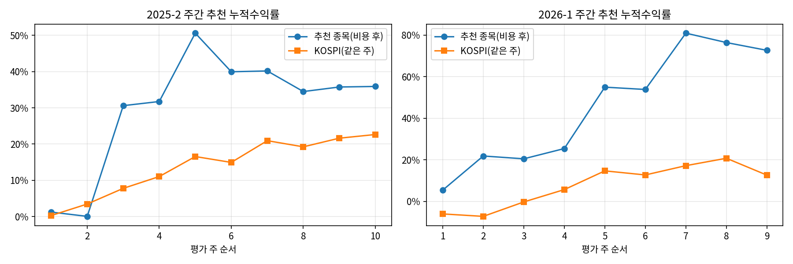

# stock-selection

수업 과제로 실제 진행한 **주간 종목 추천 19주**를 정리하고 다시 검증한 저장소.
같은 과목의 KOSPI200 선물 GA 전략은 [kospi200-ga-strategy](https://github.com/sqine/kospi200-ga-strategy)로 옮겼다.
숫자는 모두 `notebooks/` 실행 결과(`results/`)에서 가져왔다.

## 1. 문제

2025-2 투자공학과 2026-1 금융공학에서 매주 1종목을 추천하고 **추천 마감 후 첫 금요일 시가 매수 → 다음 목요일 종가 매도**로 평가받았다. 보유가 1주라서, 1주 안에 움직일 종목을 고르는 문제다.

## 2. 데이터

| 용도 | 출처 | 기간 |
|---|---|---|
| 추천 종목·주차·마감일 | LearnUs 과제 제출 내역 ([`configs/picks.csv`](configs/picks.csv)) | 2025-09 – 2026-06 |
| 주간 평가 가격 | 네이버 금융 일봉(수정주가), 벤치마크 KOSPI | 같은 기간 |
| ML 후보 모델 학습 | pykrx, KOSPI·KOSDAQ 1,089종목 주간 지표 | 2014-08 – 2025-10 |

원본 데이터·과제 문서는 저장소에 넣지 않는다(`.gitignore`). 가격은 `src/stock_selection/data.py`가 다시 받는다.

## 3. 방법

```
[2025-2] XGBoost 후보(주간 상위 5% 확률 / (1+12주 변동성)) ─┐
[2026-1] Gemini CLI 조건 스크리너(켈트너 돌파 등)        ─┼→ LLM으로 이벤트·시나리오 정리 → 1종목 선택 → 금 시가~목 종가 평가
                                                          ┘
```

| 단계 | 방법 | 이유 |
|---|---|---|
| 후보 생성 (2025-2) | XGBoost 분류기. 라벨: 주간 수익률 상위 3위·상위 5%·상위 30%·+4% 이상·−4% 이하. 입력: 기술지표 6주 래그 | 전 종목 중 1종목을 사람이 고르기는 어렵다. "다음 주 상위권일 확률"로 후보를 수십 개로 줄인다. 트리 모델은 지표 간 비선형 조합을 따로 설계하지 않아도 잡는다. |
| 위험 조정 | `확률 / (1 + 12주 변동성)` | 확률이 같으면 변동성이 낮은 종목을 앞에 둔다. 1주 보유에서 큰 손실 한 번이 누적수익률을 크게 깎기 때문이다. |
| 후보 생성 (2026-1) | Gemini CLI로 조건 스크리너 코드 생성: 켈트너 돌파(ATR 20·EMA 20), 하방 레질리언스, 모멘텀·수급, 실적 발표 전 런업 | 매주 시장 국면이 달라 조건을 바꿔야 했다. 조건은 직접 정하고 코드는 CLI가 만들어 매주 새 조건을 빠르게 시험했다. |
| 최종 선택 | LLM(Gemini)에 뉴스·변수·상승/하락 시나리오를 묻고, 차트로 진입 시점을 확인해 직접 1종목 선택 | 모델 후보표에는 실적 발표·정책·수주 같은 이벤트 정보가 없다. |
| 평가 | 금 시가 매수 → 목 종가 매도, 매수 0.015%·매도 0.195%(수수료+거래세) 차감, 같은 주 KOSPI와 비교 | 과제 평가 규칙 그대로. 보유 구간이 중간·기말고사 주간에 걸친 2주(2026-1 5·11주차)는 실제 평가에서 빠졌으므로 제외 |

**실행 전에 기대한 결과**
- 후보 모델: 무작위보다 상위권 종목을 더 자주 맞힐 것(AUC > 0.5, AP > 양성 비율).
- 최종 선택: 같은 주 KOSPI보다 높은 수익률. 1종목 1주 보유라 주별 변동은 클 것.
- 매주 왕복 거래라 비용(왕복 0.21%)이 누적에 남을 것.

## 4. 결과

### 4-1. 후보 모델 (원본 노트북 출력, `original/2025-2_ml_candidates/analyze_dataset.ipynb`)

| 모델 | 검증 AUC | 검증 AP | 양성 비율 |
|---|---|---|---|
| 주간 상위 3위 (학습 486주 / 검증 86주) | 0.7874 | 0.0337 | 0.52% (1,755/334,704) |
| 주간 상위 3위 (롤링 5폴드) | 0.7726 ± 0.0234 | 0.0306 ± 0.0099 | 〃 |
| 주간 상위 5% | 0.7296 | 0.1385 | 5.09% (16,645/327,031) |
| 주간 +4% 이상 | 0.6720 | 0.2663 | — |
| 주간 −4% 이하 | 0.6862 | 0.3020 | — |

AUC는 0.5를 넘었고 AP는 양성 비율보다 높았다. 순위 정보는 있었다.

### 4-2. 주간 종목 추천 (시험 주간 2주 제외, 비용 차감)

모든 주가 추천 시점 이후 가격으로 계산한 아웃샘플이다.

| 지표 | 2025-2 (10주) | 2026-1 (9주) | 전체 (19주) |
|---|---|---|---|
| 누적수익률(비용 후) | +35.90% | +72.65% | +134.62% |
| 누적수익률(비용 전) | +38.78% | +75.94% | +144.18% |
| KOSPI 같은 주 누적 | +22.63% | +12.60% | +38.09% |
| 연환산 변동성 | 78.98% | 70.71% | 73.95% |
| 샤프 (rf=0) | 2.36 | 4.89 | 3.54 |
| MDD | −10.70% | −4.57% | −10.70% |
| 칼마 | — | — | — |
| 회전율(거래당, 편도) | 100% | 100% | 100% |
| 거래 횟수 | 20 | 18 | 38 |
| 승률 / KOSPI 초과 주 | 70.00% · 3/10 | 55.56% · 6/9 | 63.16% · 9/19 |
| 아웃샘플 기간 | 2025-09-19 – 2025-12-04 | 2026-03-20 – 2026-06-11 | — |

- 칼마·연환산 수익률은 표본이 52주 미만이라 계산하지 않았다.
- 시험 주간을 포함하면 2026-1은 +115.76%(제외한 2주는 둘 다 SK하이닉스, 비용 후 +6.39%·+17.46%).
- 주차별 매매 내역: [`results/weekly_trades.csv`](results/weekly_trades.csv)



## 5. 한계

### 5-1. 시장 상황의 영향이 크다

2026년 상반기는 반도체 급등장이었다. 2026-1 평가 구간(2026-03-20 – 2026-06-11) 동안 KOSPI 단순 보유도 +33.55%였다.
2026-1의 9주 중 5주가 SK하이닉스다. 그 5주(2026-05-08 – 2026-06-11) 동안

| | 누적 |
|---|---|
| 주간 매매(본 전략, 비용 후) | +37.69% |
| SK하이닉스 단순 보유 | +32.06% |
| KOSPI 단순 보유 | +5.58% |

결과의 대부분은 "급등한 대형 반도체주를 계속 들고 있었다"로 설명된다. 종목 선정 능력의 증거로 보기 어렵다.

### 5-2. 몇 주에 집중돼 있다 (`results/weekly_concentration.csv`)

| | 2025-2 | 2026-1 |
|---|---|---|
| 전체 | +35.90% | +72.65% |
| 최고 1주 제외 | +4.11% | +39.72% |
| 최고 3주 제외 | −10.04% | +2.79% |

2025-2는 포스코퓨처엠(+30.53%), 두산에너빌리티(+14.32%) 두 주를 빼면 남는 수익이 거의 없다. KOSPI를 이긴 주도 10주 중 3주뿐이다.

### 5-3. 과적합 우려

- 그 시장에서 유리한 전략이었다. 이벤트(실적 발표 전 런업)·모멘텀 위주의 선택은 상승장에서 잘 맞는다. 하락장·횡보장에서 같은 결과가 나온다는 근거는 없다.
- 표본이 19주다. 샤프도 신뢰구간이 매우 넓다.
- 후보 라벨 5종 중 사람이 골랐다. 선택 자유도가 커서 다른 사람이 같은 결과를 재현하기 어렵다.

### 5-4. 평가 방법의 가정

- 추천일은 LearnUs 과제 마감일과 제출 파일 저장일에서 정했다. 2026-1 4주차(마감 04/11 00:00)는 금요일 04/10 시가로 잡았다.
- 같은 종목을 연속으로 추천한 주도 매주 목요일 매도·금요일 재매수로 계산했다(목 종가–금 시가 갭은 수익에 넣지 않음).

## 6. 재현

```bash
pip install -r requirements.txt
python -m pytest -q                               # 지표·평가 규칙 테스트
bash scripts/run_all.sh                           # 노트북 생성·실행 → results/ 갱신
```

설정은 [`configs/base.yaml`](configs/base.yaml)(비용, 시험 주간 제외 여부)에 있다.
원본 노트북과 2026-1 스크리너 코드는 [`original/`](original/)에 그대로 두었다.

## 7. AI 도구 사용 범위

| 단계 | 사용한 도구 | 범위 |
|---|---|---|
| 종목 최종 선택 (과제 당시) | Gemini 웹(2025-2), Gemini CLI(2026-1) | 뉴스·이벤트 정리, 상승/하락 시나리오, 스크리너 코드 생성. 최종 1종목은 직접 선택 |
| ML 후보 모델 (과제 당시) | 직접 작성 (확인 필요) | pykrx 수집, 지표 계산, XGBoost 학습 |
| 이 저장소 정리 | Claude | 평가 코드·테스트·노트북 작성, 문서 초안. 결과 수치는 모두 코드 실행 출력 |
