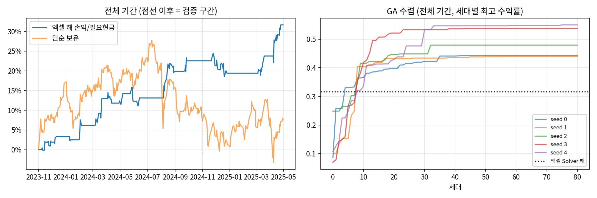

# stock-selection

수업 과제로 실제 진행한 **주간 종목 추천 19주**와 **KOSPI200 선물 GA 전략**을 정리하고 다시 검증한 저장소.
왜 이 방법을 썼는지, 기대한 결과와 실제 결과, 한계는 [`docs/methodology.md`](docs/methodology.md)에 따로 적었다.

## 1. 문제

- **주간 종목 추천** (2025-2 투자공학, 2026-1 금융공학): 매주 1종목 추천, 추천 마감 후 첫 금요일 시가 매수 → 다음 목요일 종가 매도로 평가.
- **GA 전략** (2025-2 투자공학): MFI·볼린저밴드 신호로 KOSPI200 선물을 매매하는 규칙의 파라미터 10개를 유전 알고리즘으로 찾는다.

## 2. 데이터

| 용도 | 출처 | 기간 |
|---|---|---|
| 추천 종목·주차·마감일 | LearnUs 과제 제출 내역, 제출 PPT ([`configs/picks.csv`](configs/picks.csv)) | 2025-09 ~ 2026-06 |
| 주간 평가 가격 | 네이버 금융 일봉(수정주가), 벤치마크 KOSPI | 같은 기간 |
| ML 후보 모델 학습 | pykrx, KOSPI·KOSDAQ 1,089종목 주간 지표 | 2014-08 ~ 2025-10 |
| GA | 과제 엑셀(KOSPI200 선물 Price), KOSPI 지수 OHLCV로 계산한 MFI·BB | 2023-11-01 ~ 2025-04-30 |

원본 데이터와 엑셀은 저장소에 넣지 않는다(`.gitignore`). 가격은 `src/stock_selection/data.py`가 다시 받는다.

## 3. 방법

```
[2025-2] XGBoost 후보(주간 상위 5% 확률 / (1+12주 변동성)) ─┐
[2026-1] Gemini CLI 조건 스크리너(켈트너 돌파 등)        ─┼→ LLM(Gemini) 시나리오·뉴스 정리 → 1종목 선택 → 금 시가~목 종가 평가
                                                          ┘
[GA] MFI·BB폭·%B 4개 조건 중 N개 이상 & K일 연속 → 매수/매도, 수량 4개 변수 포함 10개 파라미터를 GA로 탐색
```

- 사용한 프롬프트: [`prompts/`](prompts/README.md)
- 원본 노트북·스크리너 코드: [`original/`](original/)
- 정제한 노트북: [`notebooks/01_weekly_picks.ipynb`](notebooks/01_weekly_picks.ipynb), [`notebooks/02_ga_kospi200.ipynb`](notebooks/02_ga_kospi200.ipynb)

## 4. 결과

### 주간 종목 추천 (시험 주간 2주 제외, 비용 차감)

비용: 매수 0.015%, 매도 0.195%(수수료+거래세). 모든 주가 추천 시점 이후 가격으로 계산한 아웃샘플이다.

| 지표 | 2025-2 (10주) | 2026-1 (9주) | 전체 (19주) |
|---|---|---|---|
| 누적수익률(비용 후) | +35.90% | +72.65% | +134.62% |
| 누적수익률(비용 전) | +38.78% | +75.94% | +144.18% |
| KOSPI 같은 주 누적 | +22.63% | +12.60% | +38.09% |
| 연환산 변동성 | 78.98% | 70.71% | 73.95% |
| 샤프 (rf=0) | 2.36 | 4.89 | 3.54 |
| MDD | −10.70% | −4.57% | −10.70% |
| 칼마 | — | — | — |
| 회전율(거래당, 편도) | 100% | 100% | 100% |
| 거래 횟수 | 20 | 18 | 38 |
| 승률 / KOSPI 초과 주 | 70.00% · 3/10 | 55.56% · 6/9 | 63.16% · 9/19 |
| 아웃샘플 기간 | 2025-09-19 ~ 2025-12-04 | 2026-03-20 ~ 2026-06-11 | — |

칼마·연환산 수익률은 표본이 52주 미만이라 계산하지 않았다. 주차별 매매 내역: [`results/weekly_trades.csv`](results/weekly_trades.csv)


### GA 전략

| 지표 | 엑셀 해 · 전체 기간(인샘플) | 학습 구간 최적해(seed 4) · 검증 구간(아웃샘플) | 엑셀 해 · 검증 구간 |
|---|---|---|---|
| 수익률 (손익/필요 현금) | +31.63% | −1.19% | +8.95% |
| 연환산 수익률 | +20.96% | — | — |
| 연환산 변동성 | 10.21% | 11.38% | 12.88% |
| 샤프 (rf=0) | 1.91 | −0.16 | 1.46 |
| MDD | −4.77% | −6.59% | −5.72% |
| 칼마 | 4.40 | — | — |
| 거래 횟수 | 36 | 26 | 8 |
| 기간 | 2023-11-01 ~ 2025-04-30 | 2024-11-01 ~ 2025-04-30 | 2024-11-01 ~ 2025-04-30 |

- Python 이식본이 엑셀 결과(손익 533.31포인트, +31.63%, 매수 18회)를 행 단위로 재현한다.
- 같은 기간 단순 보유는 +7.68%.
- 학습 구간에서 찾은 해 5개의 검증 구간 수익률은 −1.19% ~ +11.90%(평균 +5.10%). 검증 구간 단순 보유는 +0.35%.



## 5. 한계

- **시장 효과가 크다.** 2026-1 평가 구간 동안 KOSPI 단순 보유도 +33.55%였다. 2026-1의 9주 중 5주가 SK하이닉스이고, 그 5주의 주간 매매 수익(+37.69%)은 SK하이닉스 단순 보유(+32.06%)와 큰 차이가 없다.
- **몇 주에 집중.** 최고 3주를 빼면 2025-2는 −10.04%, 2026-1은 +2.79%.
- **과적합 우려.** 급등장에서 유리한 이벤트·모멘텀 위주 선택이었다. 표본 19주, 후보 라벨 5종 중 사람이 고른 구조라 다른 시장에서 같은 결과를 기대하기 어렵다. GA는 학습 수익률이 가장 높은 해가 검증에서 가장 낮았다.
- **원본 ML 코드의 룩어헤드·생존편향**: 전체 기간으로 계산한 `years`·거래량 z-score·허스트 지수, 현재 상장 종목만 사용. 줄 단위 목록은 [`docs/methodology.md`](docs/methodology.md#a-5-한계).
- **GA**: 당일 종가 지표로 당일 체결, 선물 승수·증거금·비용 미반영, 검증 구간 1회(120거래일).

## 6. 재현

```bash
pip install -r requirements.txt
python -m pytest -q                               # 지표·평가 규칙·엑셀 일치 테스트
python scripts/extract_ga_excel.py <전략결과.xlsx> # GA 입력 데이터 (엑셀 원본이 있을 때)
bash scripts/run_all.sh                           # 노트북 생성·실행 → results/ 갱신
```

설정은 [`configs/base.yaml`](configs/base.yaml)(비용, 시험 주간 제외 여부, GA 세대 수·시드)에 있다.

## 7. AI 도구 사용 범위

| 단계 | 사용한 도구 | 범위 |
|---|---|---|
| 종목 최종 선택 (과제 당시) | Gemini 웹(2025-2), Gemini CLI(2026-1) | 뉴스·이벤트 정리, 상승/하락 시나리오, 스크리너 코드 생성. 최종 1종목은 직접 선택 |
| ML 후보 모델 (과제 당시) | 직접 작성 (확인 필요) | pykrx 수집, 지표 계산, XGBoost 학습 |
| GA (과제 당시) | 직접 작성 (확인 필요) | 엑셀 수식 설계, Solver 실행 |
| 이 저장소 정리 | Claude | 엑셀 수식 Python 이식, 평가 코드·테스트·노트북 작성, 원본 코드 점검(룩어헤드·생존편향), 문서 초안. 결과 수치는 모두 코드 실행 출력 |
